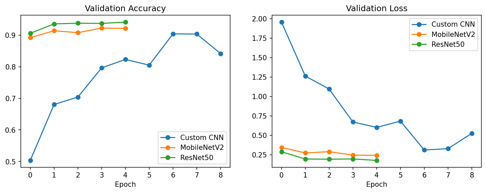
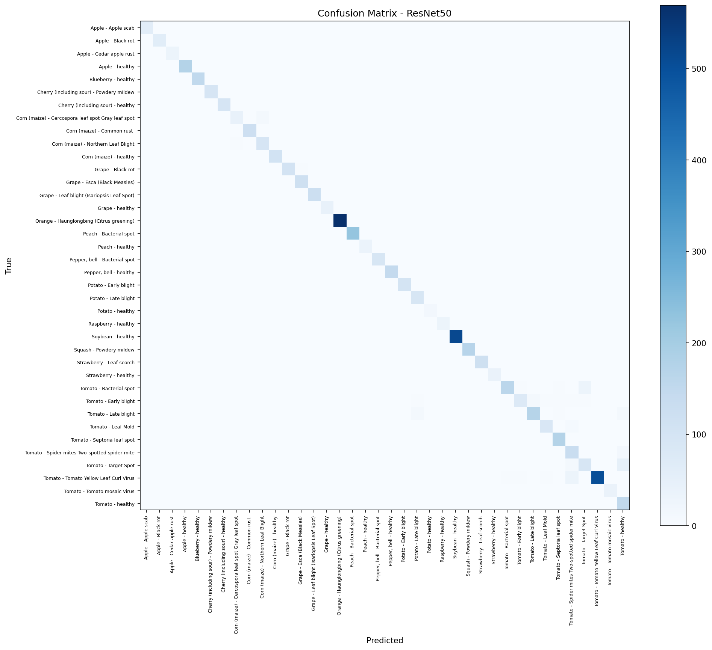
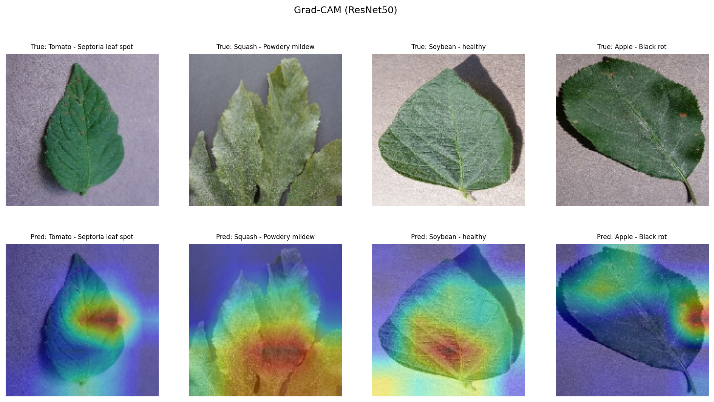

# Plant Disease Detection: Custom CNN vs. Transfer Learning

Deep learning system that identifies **38 plant leaf diseases** (14 crop species) from a single leaf photo. It compares a CNN built from scratch with two transfer-learning models (**MobileNetV2** and **ResNet50**), explains its predictions with **Grad-CAM** heatmaps and ships with a **Gradio** web demo.

## Dataset
[PlantVillage](https://github.com/spMohanty/PlantVillage-Dataset) (Hughes & Salathé, 2015): 54,305 RGB leaf images, 38 classes (26 diseases + 12 healthy) across 14 crops such as tomato, apple, potato, grape and corn. Split 80 / 10 / 10 into train / validation / test.

## Models
| Model | Type | Idea |
|---|---|---|
| Custom CNN | From scratch | 3 × (Conv → BatchNorm → MaxPool), Global Average Pooling, Dropout, Softmax |
| MobileNetV2 | Transfer learning | Frozen ImageNet base + new softmax head; lightweight, mobile-friendly |
| ResNet50 | Transfer learning | Frozen ImageNet base (residual connections) + new softmax head |

Training setup (identical for all models): 160×160 input, data augmentation (flip, rotation, zoom), Adam optimizer, sparse categorical cross-entropy, early stopping and learning-rate reduction on plateau.

## Results
Full run on Google Colab (T4 GPU), held-out test set of 5,431 images:

| Model | Test Accuracy | Test Loss | Params (M) | Trainable (M) | Epochs | Train Time |
|---|---|---|---|---|---|---|
| Custom CNN | 91.09% | 0.301 | 0.10 | 0.10 | 9 | 49.2 min |
| MobileNetV2 | 92.08% | 0.236 | 2.31 | 0.05 | 5 | 25.4 min |
| **ResNet50** | **94.55%** | **0.169** | 23.67 | 0.08 | 5 | 34.7 min |

Best model (ResNet50): macro F1 = 0.942, weighted F1 = 0.946. 12 of 38 classes reach F1 ≥ 0.995; tomato diseases (Target Spot, Spider mites, Early blight) are the hardest.

## Explainability
Grad-CAM highlights the leaf regions (lesions, spots, discoloration) that drive each prediction.

## How to run
1. Open `plant_disease_detection.ipynb` in [Google Colab](https://colab.research.google.com) (File → Upload notebook).
2. Runtime → Change runtime type → **T4 GPU**.
3. Optional: set `QUICK_TEST = True` for a ~3-minute sanity check.
4. Runtime → Run all. The full run takes about 45–60 minutes.
5. Outputs (plots, comparison table, classification report, model) are saved to `results/`, and a shareable Gradio demo link is printed at the end.

## Live demo (Streamlit)
A local web app: upload a leaf photo and it shows the predicted disease, its confidence, the top-3 predictions and a Grad-CAM heatmap.

1. Install [Python 3.10–3.12](https://www.python.org/downloads/), then run `pip install streamlit tensorflow pillow matplotlib pandas`.
2. Put `best_model.keras` (from the Colab `results.zip`) in the same folder as `app.py`.
3. Run `streamlit run app.py`. The app opens in your browser at http://localhost:8501.
4. Upload any image from `results/demo_images/` (unseen test leaves).

The app detects which model was saved (Custom CNN, MobileNetV2 or ResNet50) and applies the matching preprocessing.

## Tech stack
Python · TensorFlow / Keras · scikit-learn · Matplotlib · Gradio · Streamlit

## Author
Diya R B, B.Tech CSE (Data Science), VIT
